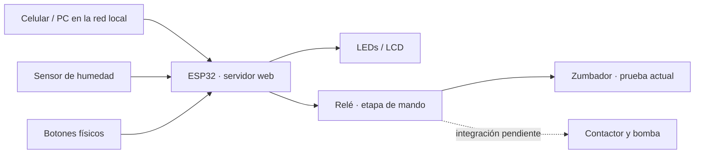
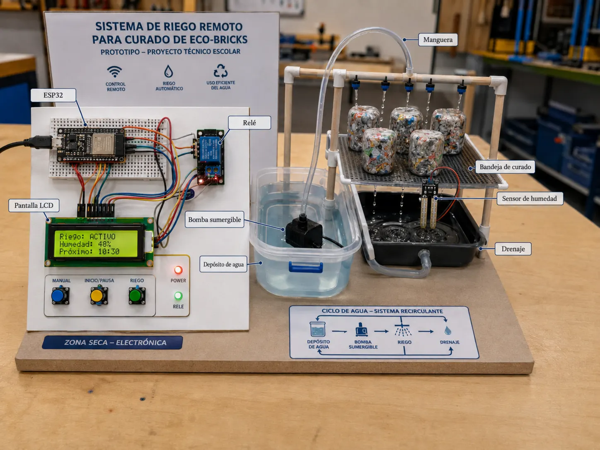

# Proyecto STEAM · Sistema de riego para curado de ladrillos ecológicos

**Proyecto académico de Laboratorio STEAM+ — Tecnicatura en Redes y Software (UTU)**  
**Estado:** prototipo electrónico y control local en desarrollo; integración hidráulica pendiente.

## 1. Necesidad real

En una fábrica familiar de ladrillos ecológicos, el curado requiere mantener condiciones de humedad. Este proyecto explora cómo **automatizar el riego** mediante un ESP32, una interfaz web y sensores. La entrega académica es una **maqueta funcional**: no se presenta como instalación industrial terminada.

## 2. Qué implementé y qué puedo mostrar

| Componente | Estado / evidencia |
| --- | --- |
| ESP32 y página web en red local | Control local del prototipo probado |
| Sensor capacitivo de humedad | Integrado en el montaje electrónico documentado |
| Relé, LEDs, botones y pantalla LCD 16x2 | Integrados en el prototipo de control |
| Activación mediante zumbador de prueba | Utilizada para simular la actuación antes de la bomba |
| Panel web con riegos temporizados | Disponible en [repositorio del panel y simulador](https://github.com/faku-20/sistema-de-riego/tree/main/panel-local) |
| API + ESP32 virtual | Simulador Node.js; **no controla hardware real** |
| Bomba real, contactor y pruebas de agua | **Pendientes de integración y validación** |
| Acceso remoto por internet | Objetivo de evolución; **no se documenta como funcional** |

> El control local del ESP32 y el simulador web son **dos entornos de prueba diferentes**. No deben confundirse con una integración extremo a extremo ya validada.

## 3. Arquitectura del prototipo



La etapa de potencia se representa solo como un **objetivo del proyecto**. Todo trabajo con 220 V necesita elementos de protección y revisión por personal competente.



## 4. Demostración reproducible del panel (sin ESP32 físico)

El panel y la API simulada están documentados en el repositorio complementario [sistema-de-riego](https://github.com/faku-20/sistema-de-riego). Permiten ejecutar una demo local con Node.js:

```bash
git clone https://github.com/faku-20/sistema-de-riego.git
cd sistema-de-riego/panel-local
node simulador-esp32-server.js
```

Abrir `http://localhost:3000` y seguir las instrucciones de [panel-local/README.md](https://github.com/faku-20/sistema-de-riego/blob/main/panel-local/README.md). En la demo se pueden crear órdenes temporizadas, detener el riego simulado y observar eventos de la ESP32 virtual.

**Alcance de la demo:** prueba el flujo del panel y las órdenes; no acredita funcionamiento de la bomba ni conectividad real del microcontrolador.

## 5. Documentación y evolución

- [Primer informe de avance](documentacion/avance1.md)
- [Segundo informe de avance](documentacion/avance2.md)
- [Registro visual del proceso: fotografías, diagramas y videos](./proyecto%20steam/)
- [Diagrama de conexiones ESP32](documentacion/conexiones-esp32.html)
- [Contrato de API del simulador](https://github.com/faku-20/sistema-de-riego/blob/main/panel-local/API.md)

Los documentos [avance 3](documentacion/avance3.md) y [documentación técnica final](documentacion/documentacion_tecnica.md) se conservan como **plantillas pendientes de completar**; no son informes terminados.

## 6. Próximos pasos

- Verificar el circuito y el montaje final de la maqueta.
- Integrar la bomba a través de la etapa de potencia revisada.
- Ejecutar y registrar pruebas de riego, sensor y cortes de seguridad.
- Consolidar la documentación técnica y, posteriormente, evaluar acceso remoto.

## Lo que demuestra

Diseño y construcción de un prototipo físico, integración de electrónica con interfaces web, elaboración de esquemas, simulación de APIs y diferenciación explícita entre funciones probadas y pendientes.

**Autor:** Facundo Pérez · Proyecto STEAM+ (UTU).
