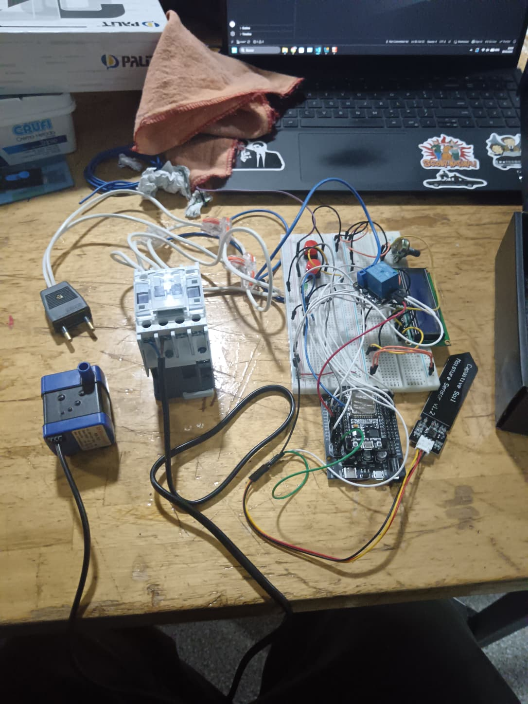
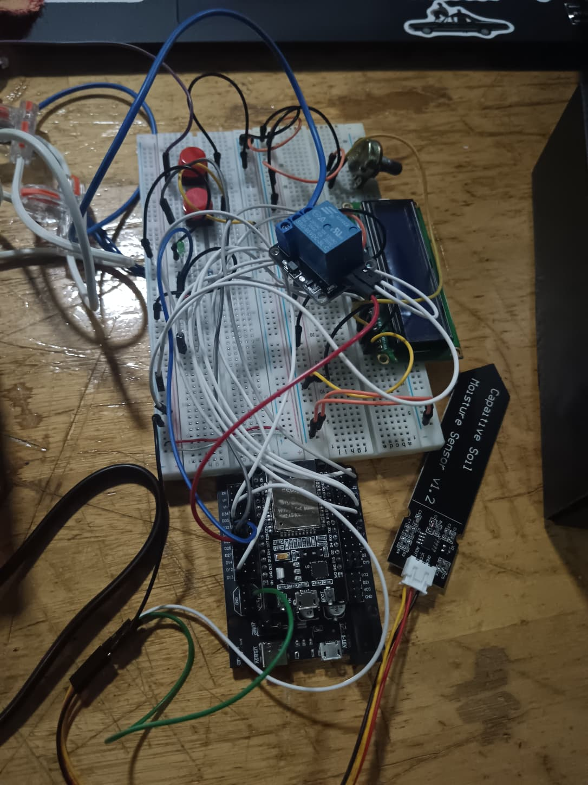
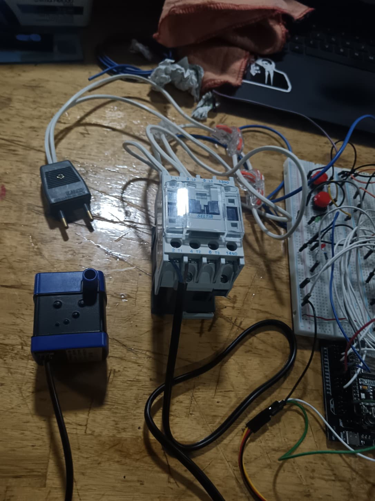
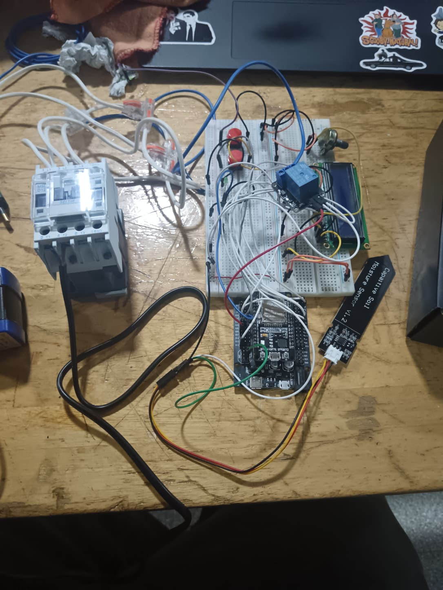
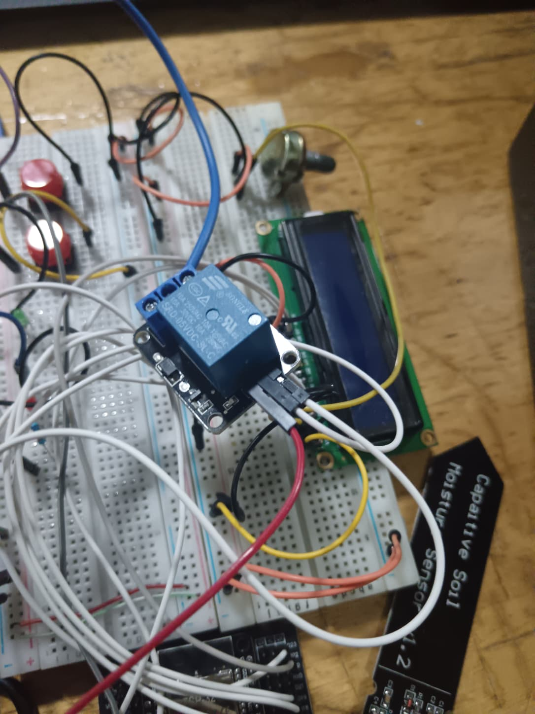
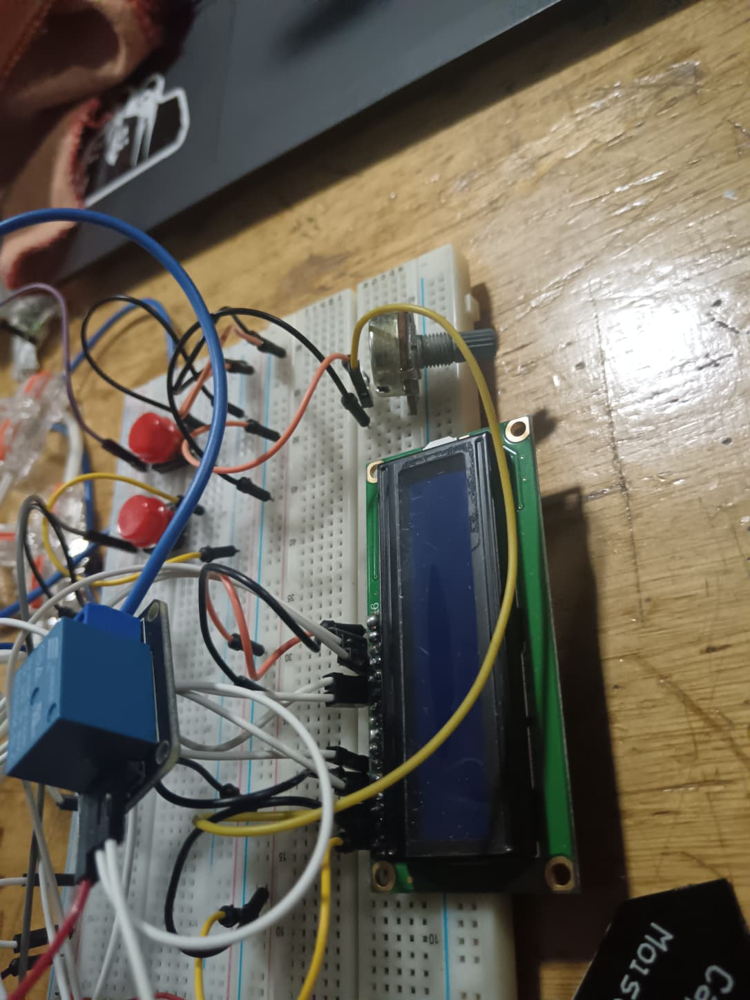
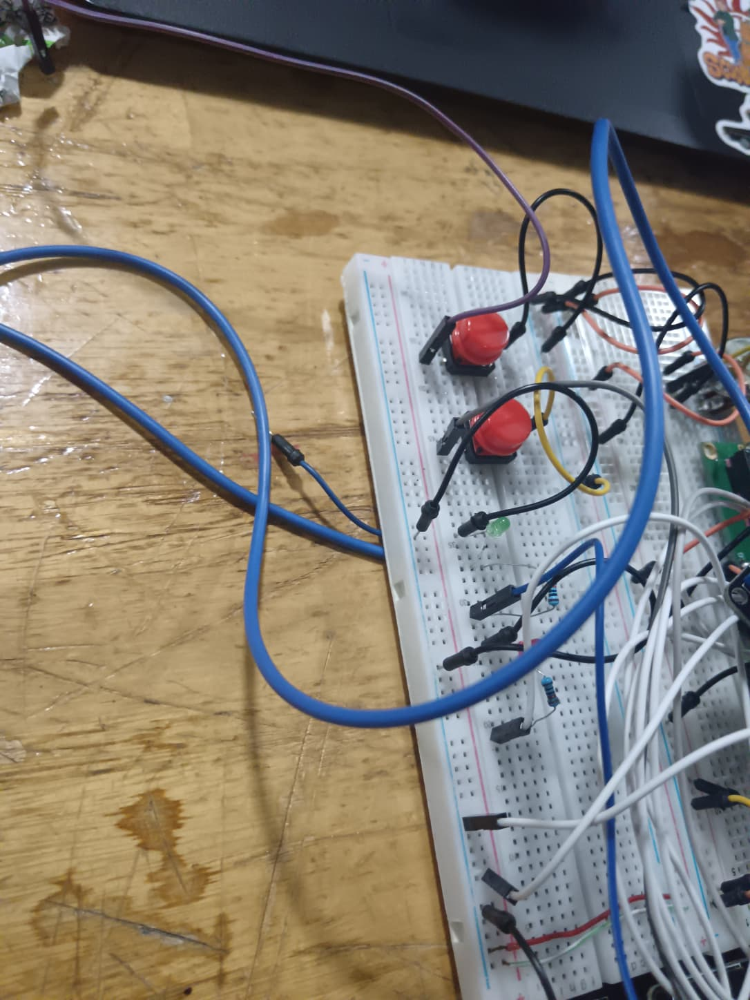

# Informe de Avance 2: Septiembre 2026

## 02/09/2026 - Semana 5: armado físico del circuito de potencia y mando

Durante esta semana se comenzó con el armado físico del circuito de potencia y mando que posteriormente permitirá controlar la bomba de 220 V mediante la ESP32.

El trabajo se enfocó en pasar del circuito electrónico de prueba hacia un montaje más cercano al sistema real, incorporando el contactor, borneras y una placa de expansión para organizar mejor las conexiones.

### Tareas completadas

- Se realizaron las primeras conexiones del contactor.
- Se compró una placa de expansión para la ESP32, para facilitar el acceso y la organización de los pines.
- Se compraron borneras para distribuir de forma más ordenada la fase y el neutro.
- Se comenzó a preparar el circuito de mando del contactor.
- Se mantuvo separado el circuito de control de la ESP32 del circuito de 220 V.

### Circuito de mando planteado

```text
Fase → COM del relé
NO del relé → A1 del contactor
Neutro → A2 del contactor
```

De esta forma, el relé funciona como interruptor de la fase que llega a la bobina del contactor. Cuando el relé se activa, permite que la fase llegue a A1 y el contactor pueda accionar. El terminal A2 permanece conectado al neutro.

### Problemas encontrados y soluciones propuestas

Durante las conexiones fue necesario revisar cómo debía alimentarse correctamente la bobina del contactor y cómo utilizar los contactos COM y NO del relé.

Se definió que el relé no debe alimentar directamente la bomba, sino actuar sobre el circuito de mando del contactor. Esto permite que la ESP32 trabaje con baja tensión y que el contactor se encargue de controlar la parte de potencia de 220 V.

También se mantuvo como criterio de seguridad separar físicamente la electrónica de control del circuito de 220 V.

### Próximos pasos

- Terminar las conexiones del contactor y relé.
- Instalar la protección eléctrica correspondiente.
- Conectar la placa de expansión de la ESP32.
- Realizar pruebas del contactor sin conectar todavía la bomba.
- Posteriormente conectar la bomba y comenzar las pruebas hidráulicas.

### Estado al finalizar la semana

Se comenzó a pasar del circuito electrónico de prueba al montaje real que permitirá controlar la bomba de 220 V mediante relé y contactor.

## 16/09/2026 — Avance de clase

Durante esta clase se continuó con el armado del sistema, principalmente en la parte eléctrica y en la organización de las conexiones.

### Tareas completadas

- Se incorporó una placa de expansión para la ESP32, facilitando el acceso a los pines.
- Se avanzó con las conexiones del relé y el contactor.
- Se utilizaron borneras para organizar las conexiones de fase y neutro.
- Se continuó preparando el circuito que permitirá controlar la bomba de 220 V desde la ESP32.

### Problemas encontrados y soluciones

Se decidió utilizar una placa de expansión en lugar de fabricar un soporte 3D para la ESP32, ya que permite realizar las conexiones de forma más cómoda y ordenada.

### Próximos pasos

- Terminar el circuito de potencia.
- Incorporar la bomba.
- Revisar todas las conexiones.
- Preparar una prueba segura del sistema con 220 V.

## 30/09/2026 — Avance de clase

Durante esta etapa se terminó de armar gran parte del sistema necesario para controlar la bomba real.

### Tareas completadas

- Se instaló el contactor en el circuito.
- Se conectó la bomba de agua de 220 V.
- Se realizaron las conexiones entre la ESP32, el relé, el contactor y la bomba.
- Se organizó el circuito utilizando la placa de expansión y las borneras.
- Se tomaron fotografías del circuito armado.

El funcionamiento planteado es:

```text
ESP32 → Relé → Contactor → Bomba 220 V
```

### Evidencia fotográfica del montaje

Las siguientes fotografías documentan el armado físico realizado durante esta etapa:



*Figura 1. Pulsadores y LED de señalización del circuito de control.*



*Figura 2. Vista general del sistema durante el armado.*



*Figura 3. Integración de la ESP32, el relé y el sensor de humedad del suelo.*



*Figura 4. Contactor y bomba utilizados en el circuito de potencia.*



*Figura 5. Módulo relé empleado como interfaz entre la ESP32 y el contactor.*



*Figura 6. Vista general de las conexiones del sistema.*



*Figura 7. Pantalla LCD y controles de interfaz del sistema.*
