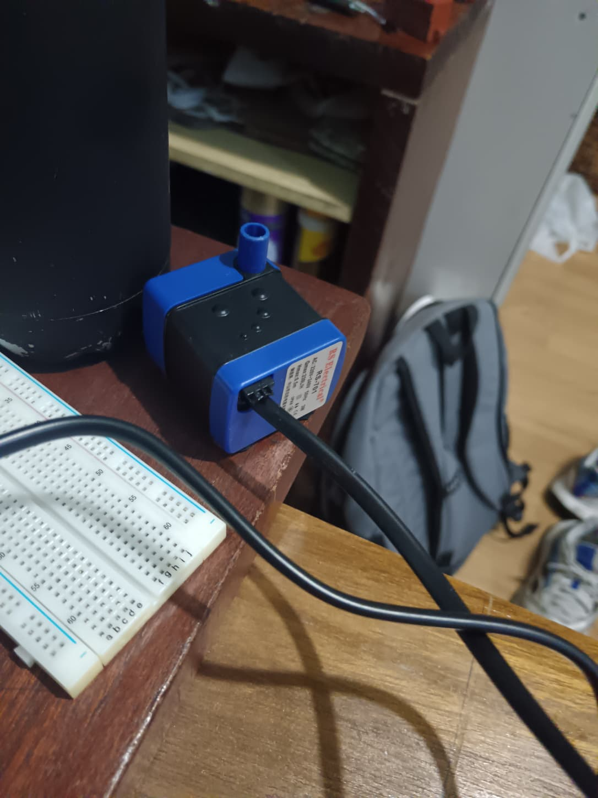
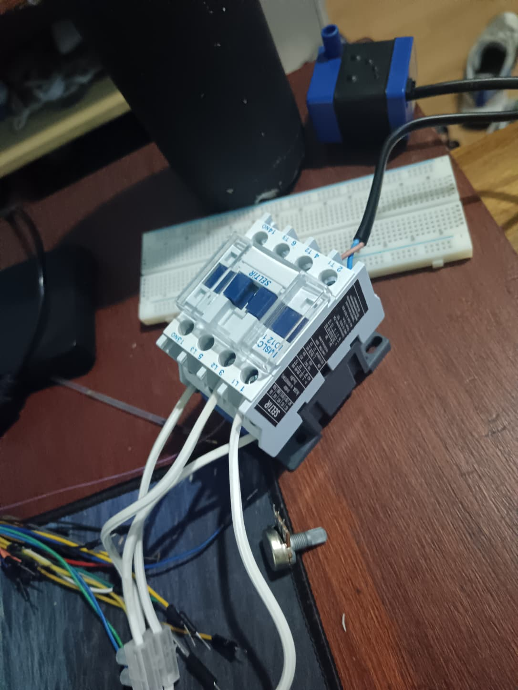
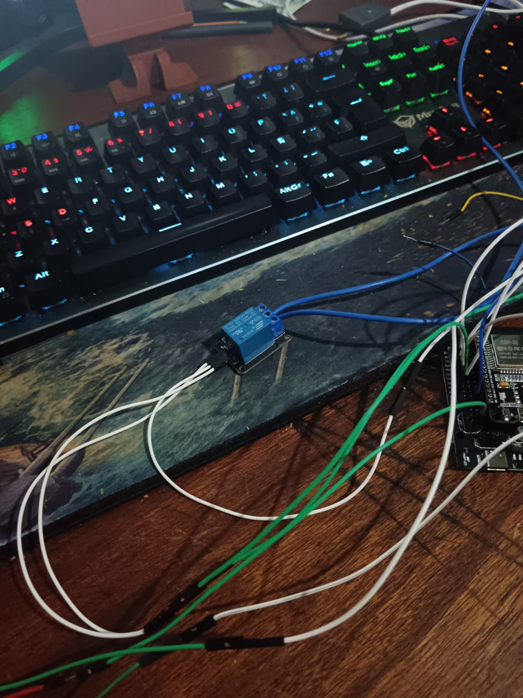
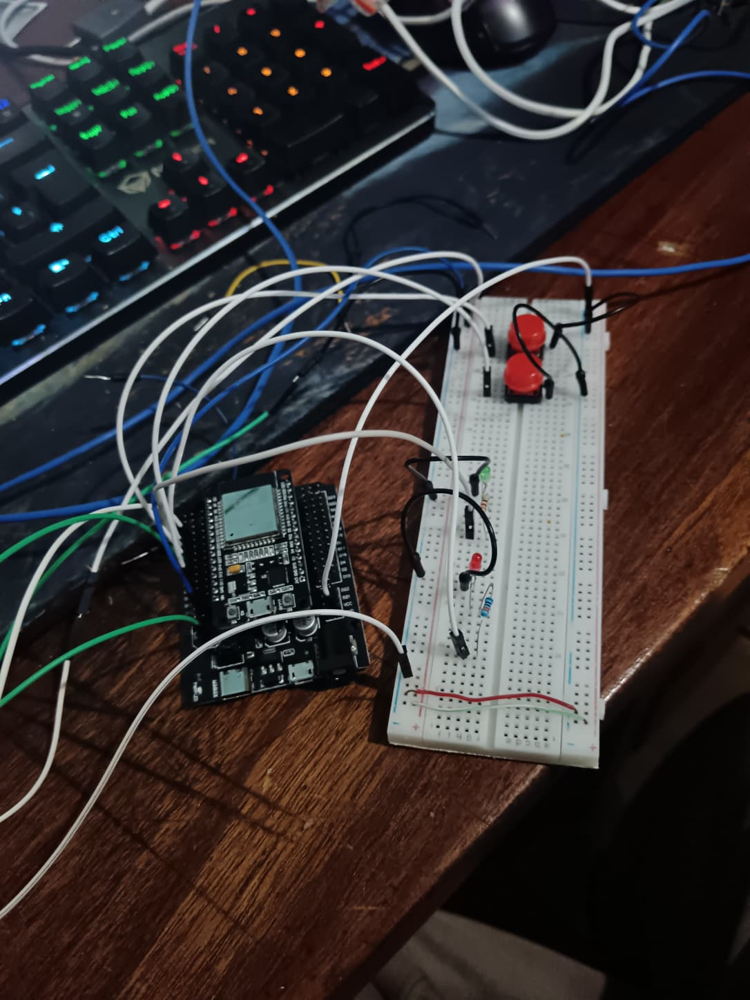
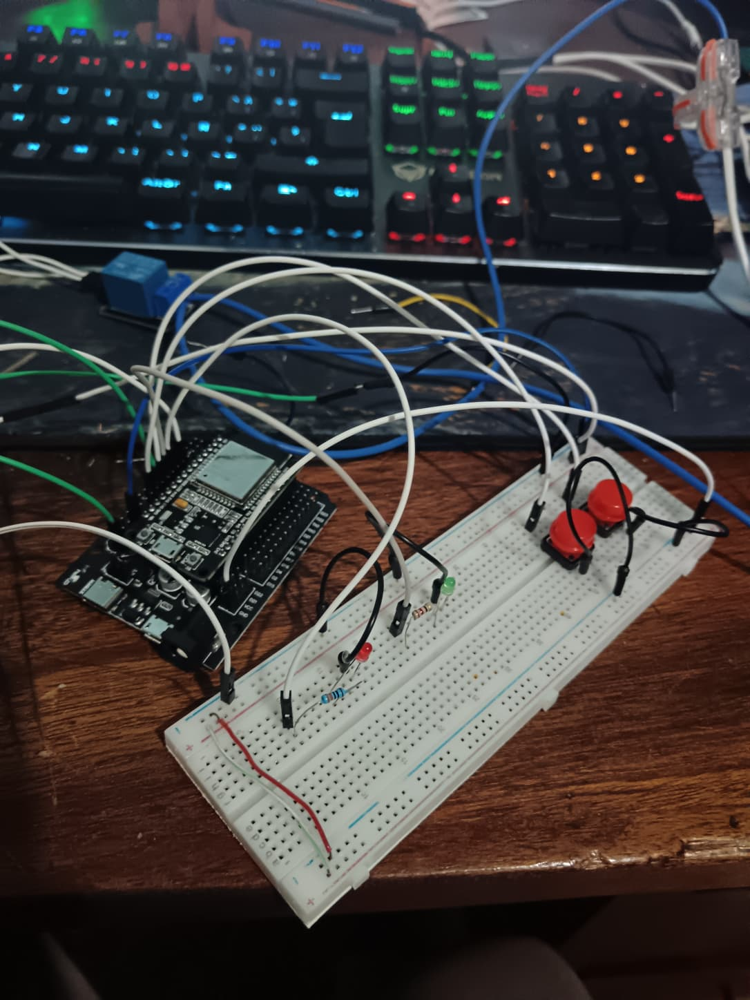

# Informe de Avance 3: Octubre 202x

## 07/10/2026 — Sin clases

Esta semana no fui a clases, por lo que no se realizaron actividades ni avances correspondientes a la jornada de UTU.

---

## 14/10/2026 — Avance de clase

Durante esta semana se realizaron las primeras pruebas del circuito conectado a la corriente de 220 V, logrando hacer funcionar la bomba de agua mediante la ESP32, el relé y el contactor.

### Tareas completadas

- Se terminaron de conectar el relé, el contactor y la bomba de agua.
- Se realizaron las primeras pruebas utilizando alimentación de 220 V.
- Se comprobó que la ESP32 puede activar y desactivar la bomba mediante el relé y el contactor.
- Se retiró el buzzer que anteriormente simulaba el funcionamiento de la bomba.
- Se verificó el funcionamiento del control electrónico con la bomba real.

### Problemas encontrados y soluciones

La principal dificultad fue realizar correctamente las conexiones del circuito de potencia, ya que se estaba trabajando por primera vez con 220 V.

Después de revisar las conexiones, se logró poner en funcionamiento el sistema. Sin embargo, todavía queda pendiente incorporar las protecciones y realizar una revisión completa de la seguridad eléctrica.

### Próximos pasos

- Revisar el circuito eléctrico con una persona calificada.
- Incorporar las protecciones correspondientes.
- Organizar y asegurar el cableado.
- Diseñar una caja para contener todos los componentes.
- Preparar las pruebas del sistema de riego con agua.

### Evidencia audiovisual

[Ver video de la primera prueba de funcionamiento de la bomba](imagenes/avance3/14-10-2026/prueba-bomba-220v.mp4)

*Video 1. Primera prueba de la bomba controlada mediante la ESP32, el relé y el contactor.*

**Estado actual:** se logró hacer funcionar la bomba de 220 V mediante el sistema electrónico. Queda pendiente completar el montaje seguro y realizar las pruebas correspondientes.

---

## 21/10/2026 — Modificaciones del circuito y diseño 3D

Durante esta semana se realizaron modificaciones en el circuito electrónico para simplificar las conexiones y reducir el espacio ocupado por los componentes. También se continuó trabajando en el diseño de una caja 3D para contener todo el sistema.

### Tareas completadas

- Se retiró la pantalla LCD, ya que la información del sistema se puede consultar desde la interfaz web de la ESP32.
- Se eliminó el buzzer utilizado anteriormente para simular la bomba.
- Se reorganizaron las conexiones de la protoboard, dejando principalmente los LEDs, las resistencias y los botones.
- Se utilizó la placa de expansión de la ESP32 para facilitar las conexiones.
- Se simplificó el cableado, aprovechando la protoboard para distribuir la alimentación y el GND de algunos componentes.
- Se tomaron medidas de la protoboard, la placa de expansión y el contactor.
- Se creó un primer prototipo STL de una caja portátil para contener el circuito completo.

### Problemas encontrados y soluciones

El circuito ocupaba demasiado espacio y tenía muchos cables sueltos. Para solucionarlo, se retiraron componentes innecesarios y se reorganizaron las conexiones.

También se detectó que el contactor era más grande de lo previsto, por lo que fue necesario reconsiderar las dimensiones de la caja.

### Próximos pasos

- Ajustar las dimensiones de la caja 3D.
- Diseñar los soportes para fijar los componentes.
- Preparar los agujeros para los botones, LEDs y cables.
- Incorporar un compartimiento eléctrico adecuado para las conexiones de 220 V.
- Realizar las primeras pruebas de impresión.

### Evidencia audiovisual

*Figura 1. bomba tuilizada en el circuito.*

*Figura 2. Contactor conectado al circuito.*

*Figura 3. relé conectado al circuito.*

*Figura 4. Detalle del circuito y sus conexiones.*

*Figura 5. Vista general del ciircuito de control .*

[Ver video del montaje — parte 1](imagenes/avance3/21-10-2026/video-montaje-01.mp4)

[Ver video del montaje — parte 2](imagenes/avance3/21-10-2026/video-montaje-02.mp4)

## 28/10/2026 — Reorganización del circuito

Durante esta clase se trabajó en mejorar la organización del cableado del circuito electrónico, buscando que las conexiones quedaran más prolijas y ordenadas.

### Tareas completadas
- Se reorganizaron los cables del circuito.
- Se mejoró la distribución de las conexiones entre la ESP32, la protoboard y los demás componentes.
- Se acomodó el cableado para facilitar la identificación de las conexiones y el mantenimiento del sistema.

### Problemas encontrados y soluciones
El circuito tenía varios cables desordenados que dificultaban identificar las conexiones. Para solucionarlo, se reacomodaron los cables y se mejoró su distribución, sin modificar el funcionamiento general del sistema.

### Próximos pasos
- Continuar ajustando el diseño 3D de la caja.
- Verificar que los componentes y cables entren correctamente.
- Preparar el montaje definitivo del circuito.
