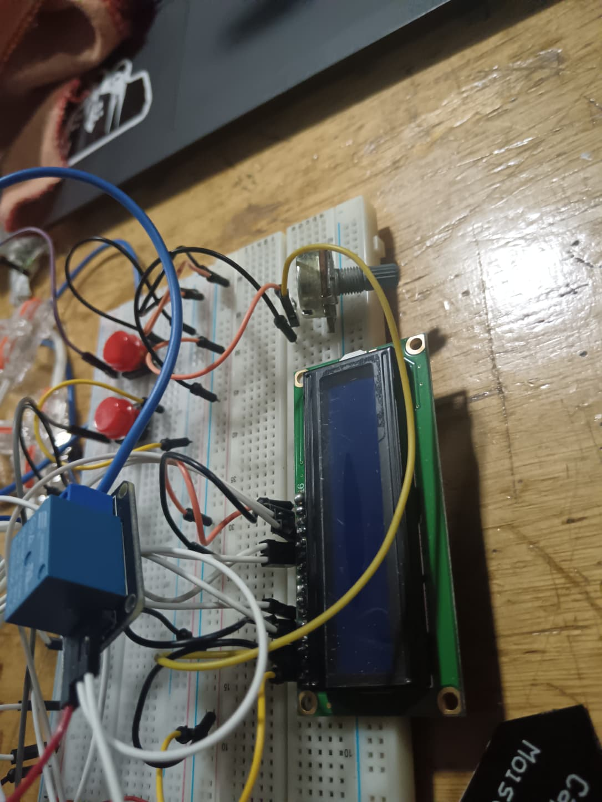
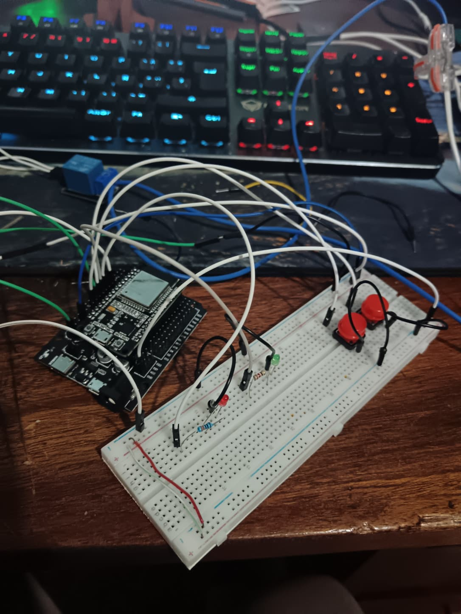
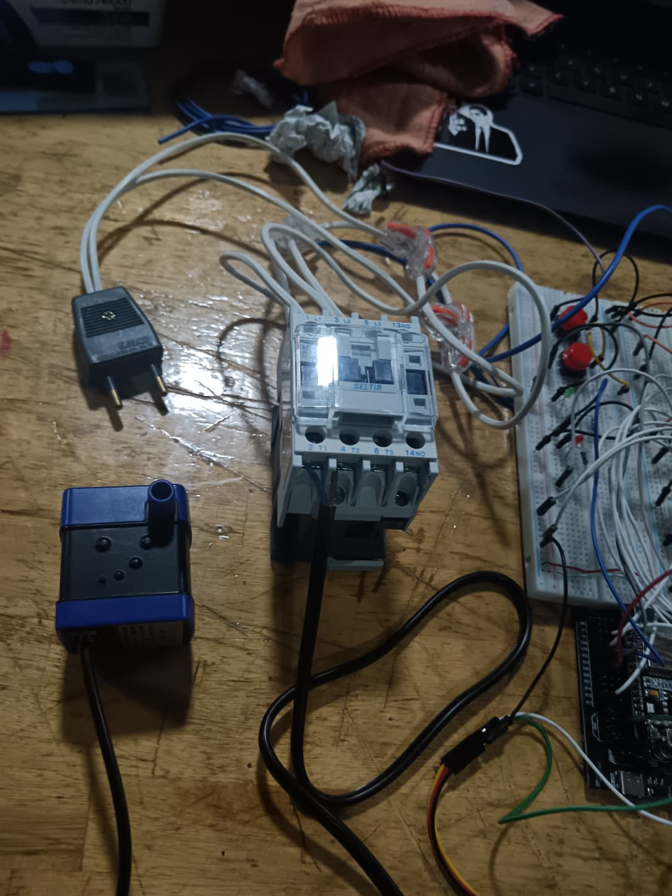

# Documentación Técnica

*Fecha de actualización: 4 de noviembre de 2026*

Este documento registra la documentación técnica del proyecto STEAM del curso **Laboratorio STEAM+** de la tecnicatura **Redes y Software** del **Instituto Superior Brazo Oriental (ISBO)** de **UTU**, año 2026.

# Proyecto: Sistema de riego para el curado de ladrillos ecológicos

## 1. Integrantes

- **Facundo Pérez**
- **Institución:** Instituto Superior Brazo Oriental (ISBO)

## 2. Descripción

El proyecto consiste en un prototipo de sistema de riego controlado mediante una ESP32 para representar la humectación requerida durante el curado de ladrillos ecológicos. La necesidad surge de una fábrica familiar, donde el riego debe realizarse de forma periódica.

La maqueta integra una ESP32, un sensor capacitivo de humedad, botones físicos, LEDs y una interfaz web local. El usuario se conecta a la red Wi-Fi creada por la ESP32, consulta el estado y activa un riego temporizado de 5, 10 o 20 segundos. La bomba se controla mediante un relé y una etapa de maniobra con contactor.

Durante el desarrollo se retiraron la pantalla LCD y el buzzer, porque la interfaz web y la bomba real hicieron innecesarios esos componentes. El proyecto sigue siendo un prototipo educativo: una prueba de encendido de la bomba a 220 V no equivale a un montaje eléctrico seguro ni validado profesionalmente.

### Objetivo general

Construir y documentar un prototipo de control de riego que permita activar y detener una bomba, consultar humedad y visualizar el estado del sistema desde una interfaz web local.

### Objetivos específicos

- Usar una ESP32 para procesar entradas y controlar el riego.
- Permitir encendido temporizado y parada desde una página web.
- Incorporar botones físicos de arranque y parada, junto con LEDs de estado.
- Registrar la lectura de un sensor capacitivo de humedad.
- Organizar el prototipo en una caja portátil diseñada en 3D.
- Mantener separadas las etapas de baja tensión y potencia.

## 3. Materiales

| Material | Cantidad | Función | Estado / observaciones |
| --- | ---: | --- | --- |
| ESP32 DevKit V1, 30 pines | 1 | Control y servidor web local | En uso |
| Placa de expansión para ESP32 | 1 | Distribución de conexiones | En uso |
| Protoboard | 1 | Conexiones de baja tensión | En uso; no se utiliza para 220 V |
| Módulo relé de un canal, 5 V | 1 | Señal de mando | En uso |
| Contactor | 1 | Maniobra de la bomba | En uso; faltan modelo y datos exactos |
| Bomba sumergible RS Electrical RS-701 | 1 | Impulsar agua | 220–240 V CA, 3 W, 230 L/h, altura máx. 0,5 m |
| Sensor capacitivo de humedad | 1 | Lectura de humedad | En uso, alimentado a 3,3 V |
| Pulsadores | 2 | Arranque y parada física | En uso |
| LED rojo y LED verde | 1 de cada | Indicadores de estado | En uso |
| Resistencias de 330 Ω | 2 | Limitar corriente de LEDs | Confirmar valor en montaje final |
| Borneras, cables y conductores | Varios | Interconexión y distribución | En uso |
| Manguera, recipiente y bandeja | Según maqueta | Circuito hidráulico | Pendiente de montaje final |
| Caja diseñada en 3D | 1 | Organización y transporte | Prototipo STL; no es envolvente certificada |
| Fuente de baja tensión | 1 | Alimentar ESP32 y periféricos | Definición final pendiente |

*Figura 1. Montaje documentado durante el avance 2.*

## 4. Diseño Mecánico

La bomba se ubica en un recipiente de agua externo a la caja electrónica y envía agua mediante una manguera hacia la zona que representa el curado. El excedente debe recogerse en una bandeja para impedir que alcance los componentes eléctricos.

Se diseñó un primer modelo STL para una caja portátil. La distribución propuesta es: placa de expansión con ESP32, protoboard, relé y contactor. Los LEDs, botones y acceso USB deben ser accesibles desde el exterior. El modelo es dimensional y todavía debe verificarse antes de imprimirlo o usarlo en un montaje definitivo.

### Ensamblaje previsto

1. Medir componentes y puntos de fijación antes de ajustar el modelo 3D.
2. Probar el encaje con piezas de impresión pequeñas.
3. Fijar la ESP32, la placa de expansión y la protoboard en la zona de baja tensión.
4. Instalar LEDs y pulsadores en un panel accesible.
5. Mantener los cables de señal ordenados e identificables.
6. Mantener depósito, mangueras y posibles salpicaduras alejados de la caja.
7. No instalar ni energizar conexiones de 220 V en una carcasa FDM común: la etapa de potencia requiere envolvente, bornes, prensaestopas, protecciones y revisión profesional.

*Figura 2. Referencia del montaje antes de la caja definitiva.*

## 5. Diseño Electrónico

La ESP32 recibe la lectura analógica del sensor, detecta los botones y procesa las solicitudes web. La salida GPIO 26 gobierna un relé de 5 V. El relé interviene en el mando de la bobina del contactor, y los contactos del contactor conmutan la alimentación de la bomba. Los LEDs indican si el riego está activo o detenido.

La protoboard y los cables Dupont se usan solamente para baja tensión. La etapa de 220–240 V debe permanecer fuera de la protoboard y requiere protecciones, puesta a tierra cuando corresponda, aislamiento, conductores adecuados, retención de cables y una envolvente eléctrica apta.

### Asignación de señales documentada

| Elemento | GPIO ESP32 | Descripción |
| --- | --- | --- |
| Relé | GPIO 26 | Control activo en nivel bajo según el firmware histórico |
| Botón de arranque | GPIO 25 | Entrada con `INPUT_PULLUP`; inicia 5 s |
| Botón de parada | GPIO 27 | Entrada con `INPUT_PULLUP`; parada inmediata |
| LED rojo | GPIO 32 | Indicador de riego detenido |
| LED verde | GPIO 33 | Indicador de riego activo |
| Sensor capacitivo, AOUT | GPIO 34 | Lectura analógica |

El sensor se alimentó con 3,3 V. La calibración inicial registrada fue: valor seco/aire **2463** y valor húmedo **959**. Esos valores son orientativos y deben recalibrarse si cambia el sensor o el material medido.

*Figura 3. Circuito de control de baja tensión.*

### Etapa de potencia y seguridad

La arquitectura ensayada fue `ESP32 → relé → contactor → bomba 220 V`. El 14/10/2026 se registró una prueba de encendido y apagado de la bomba. Esta evidencia demuestra el funcionamiento de mando, pero no certifica la seguridad eléctrica del conjunto. Antes de operar nuevamente con tensión de red, la etapa debe ser revisada por una persona calificada e incorporar las protecciones y envolvente correspondientes.

[Ver video de la prueba de bomba del 14/10/2026](imagenes/avance3/14-10-2026/prueba-bomba-220v.mp4)

## 6. Diseño Software

La ESP32 se programa con **Arduino IDE** y el framework Arduino para ESP32. Crea el punto de acceso Wi-Fi `CuradoLadrillos`; desde un teléfono o computadora conectado se accede a `http://192.168.4.1`.

La interfaz muestra el porcentaje de humedad y el estado de la bomba, permite iniciar riego por 5, 10 o 20 segundos y detenerlo. El temporizador se ejecuta en la ESP32, por lo que el ciclo termina aunque el navegador se cierre.

### Bloques principales

1. Configuración de GPIO, botones con `INPUT_PULLUP`, LEDs, relé y puerto serie.
2. Creación del punto de acceso Wi-Fi y servidor HTTP.
3. Lectura analógica y conversión orientativa de humedad a porcentaje.
4. Inicio, temporización y parada del riego mediante `millis()`.
5. Respuesta a botones físicos y a comandos de la página web.
6. Actualización de LEDs según el estado del relé.

### Código fuente

El [firmware de la versión inicial](../codigo/version-inicial/riego_curado_ladrillos.ino) se conservó en el repositorio. Esa versión incluye LCD y buzzer, componentes que se retiraron el 21/10/2026; por ello sirve como evidencia de la evolución y como referencia de los bloques de Wi-Fi, sensor, botones, relé y temporizador. El firmware final simplificado debe guardarse en `codigo/version-final/` cuando se confirme el cableado definitivo.

## 7. Referencias y recursos

- [Arduino IDE](https://www.arduino.cc/en/software)
- [Documentación de Arduino-ESP32](https://docs.espressif.com/projects/arduino-esp32/en/latest/)
- [Documentación técnica de Espressif](https://www.espressif.com/en/support/documents/technical-documents)
- [Tinkercad](https://www.tinkercad.com/)
- [OpenSCAD](https://openscad.org/)
- [Bambu Studio](https://bambulab.com/en/download/studio)
- Informes del proyecto: [avance 1](avance1.md), [avance 2](avance2.md) y [avance 3](avance3.md).

## 8. Otros

### Evolución del prototipo

| Fecha | Avance |
| --- | --- |
| 26/08/2026 | Se integraron ESP32, sensor, Wi-Fi local, interfaz web, LEDs, botones, relé, LCD y buzzer temporal. |
| 30/09/2026 | Se documentó el montaje de ESP32, relé, contactor y bomba. |
| 14/10/2026 | Se registró una prueba de encendido y apagado de la bomba mediante relé y contactor. |
| 21/10/2026 | Se retiraron LCD y buzzer, se simplificó el circuito y se inició el diseño de caja 3D. |
| 28/10/2026 | Se reorganizó el cableado para facilitar la identificación y el mantenimiento. |

### Pendientes para cierre

- [ ] Verificar el cableado final contra el firmware final simplificado.
- [ ] Definir fuente de alimentación y montaje hidráulico definitivo.
- [ ] Completar diagrama actualizado de baja tensión.
- [ ] Validar profesionalmente la etapa de potencia, sus protecciones y su envolvente.
- [ ] Documentar la impresión y validación de la caja 3D.
